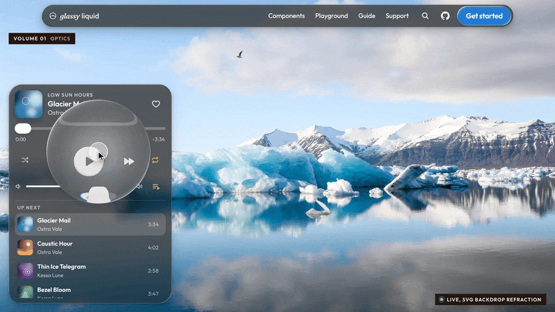
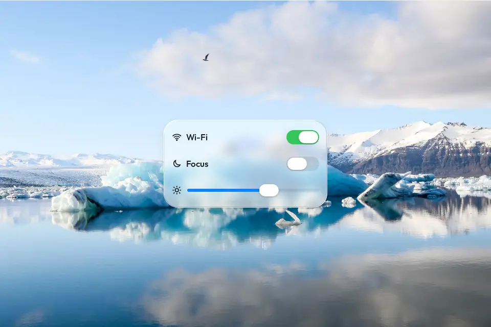

# glassy-liquid

[](https://github.com/9und30/glassy-liquid/actions/workflows/ci.yml)
[](https://www.npmjs.com/package/glassy-liquid)
[](#performance)
[](LICENSE)

Apple-style Liquid Glass for the web: real refraction, the core iOS 26 Liquid Glass controls, and typed bindings for Web Components, React, Vue, and Svelte.

**Docs, live demos, and the playground: <https://9und30.github.io/glassy-liquid/>**

<p align="center">
  
</p>

## Why glassy-liquid

- **The core iOS 26 Liquid Glass controls.** Buttons, switches, sliders, a tab bar, a segmented control, menus, toolbars, search, sheets, and scroll-edge blur, plus a generic surface and a scene. Nineteen components, one look.
- **Safari, iOS, and Firefox included.** Chromium refracts the live page. Inside `<glass-scene>`, WebKit and Firefox refract photos, video, and DOM through WebGL or a scoped content filter. Every other engine gets a calibrated frost with the same rim light, tint, shadow, and motion.
- **Accessible by default.** `prefers-reduced-motion` drops the elasticity, `prefers-reduced-transparency` makes the material opaque, and forced colors switch to system colors. Prominent labels stay at a 4.5:1 contrast.
- **About 35.9 kB gzip.** `dist/glassy-liquid.min.js` is 35.9 kB gzip and registers every element. Zero runtime dependencies. No WebGPU.
- **Web Components, React, Vue, and Svelte.** One binding table in `src/bindings/specs.ts` drives all three frameworks. A parity test keeps them 1:1.

> Not affiliated with Apple. Liquid Glass names the design language this library recreates.

<p align="center">
  
</p>

## Contents

- [Quick start](#quick-start)
- [Usage](#usage)
- [SSR and hydration](#ssr-and-hydration)
- [API reference](#api-reference)
- [Theming](#theming)
- [Browser support](#browser-support)
- [Accessibility](#accessibility)
- [Performance](#performance)
- [Coming from liquid-glass-react](#coming-from-liquid-glass-react)
- [FAQ](#faq)
- [Contributing](#contributing)
- [License](#license)

## Quick start

```sh
# snippet: install
npm install glassy-liquid
```

With a bundler such as Vite, register the elements once, then write HTML. Without a build step, use the CDN module shown below instead: a bare `import "glassy-liquid/elements"` only resolves through a bundler or an import map. Wrap a photograph in `<glass-scene>` so Safari, iOS, and Firefox refract it too. `src` accepts any image URL. The photograph below is public, so the example works when pasted. If the image fails, the scene hides the broken icon and keeps `linear-gradient(160deg, #9bb7c9, #e7eef2)`.

```html
<!-- snippet: quick-start -->
<script type="module">
  import "glassy-liquid/elements";
</script>

<glass-scene src="https://upload.wikimedia.org/wikipedia/commons/thumb/5/58/Iceberg_reflection_in_J%C3%B6kuls%C3%A1rl%C3%B3n_%28Unsplash%29.jpg/960px-Iceberg_reflection_in_J%C3%B6kuls%C3%A1rl%C3%B3n_%28Unsplash%29.jpg" style="height: 100vh; background: linear-gradient(160deg, #9bb7c9, #e7eef2)">
  <glass-button variant="prominent">Continue</glass-button>
</glass-scene>
```

React 18 or 19. In the Next.js App Router this component uses state, so its file starts with `"use client"`:

```tsx
"use client";
// snippet: react-settings
import { useState } from "react";
import { GlassScene, GlassButton, GlassSwitch, GlassSlider } from "glassy-liquid/react";

export function Settings() {
  const [wifi, setWifi] = useState(true);
  const [level, setLevel] = useState(50);
  return (
    <GlassScene src="https://upload.wikimedia.org/wikipedia/commons/thumb/5/58/Iceberg_reflection_in_J%C3%B6kuls%C3%A1rl%C3%B3n_%28Unsplash%29.jpg/960px-Iceberg_reflection_in_J%C3%B6kuls%C3%A1rl%C3%B3n_%28Unsplash%29.jpg" style={{ height: "100vh", background: "linear-gradient(160deg, #9bb7c9, #e7eef2)" }}>
      <GlassSwitch checked={wifi} onCheckedChange={setWifi} aria-label="Wi-Fi" />
      <GlassSlider value={level} onValueChange={setLevel} />
      <GlassButton variant="prominent">Done</GlassButton>
      <p className="readout">{wifi ? "on" : "off"} {Math.round(level)}</p>
    </GlassScene>
  );
}
```

Without a build step, load the single module from a CDN. The path matches the `glassy-liquid/cdn` export (`dist/glassy-liquid.min.js`):

```html
<!-- snippet: cdn -->
<script type="module" src="https://cdn.jsdelivr.net/npm/glassy-liquid@0.1/dist/glassy-liquid.min.js"></script>

<glass-surface radius="28" style="padding: 20px">
  Hello, glass.
</glass-surface>
```

## Usage

### Web Components

`import "glassy-liquid/elements"` defines every tag. Attributes are kebab-case (`light-angle` for `lightAngle`). Listen for the DOM events in the [API reference](#api-reference) (`change`, `input`, `select`, `toggle`, `search`, `detent`) plus native `click`.

### React

Import from `glassy-liquid/react`. Callback props are `onCheckedChange`, `onValueChange`, `onValueCommit`, `onSelect`, `onOpenChange`, `onSearch`, and `onDetentChange`. Uncontrolled initial values are `defaultChecked` and `defaultValue`. The ref is the custom element.

`useGlass` turns any element into glass:

```tsx
// snippet: use-glass
import { useRef } from "react";
import { useGlass } from "glassy-liquid/react";

export function Card() {
  const ref = useRef<HTMLDivElement>(null);
  useGlass(ref, { radius: 28 });
  return <div ref={ref} className="card">Card</div>;
}
```

### Vue

Vue 3. Same components and prop names as React. Each framework is an optional peer dependency.

```vue
<!-- snippet: vue-settings -->
<script setup lang="ts">
import { ref } from "vue";
import { GlassScene, GlassSwitch, GlassSlider, GlassButton } from "glassy-liquid/vue";

const wifi = ref(true);
const level = ref(50);
function save(value: number) {
  level.value = value;
}
function done() {
  wifi.value = false;
}
</script>

<template>
  <GlassScene src="https://upload.wikimedia.org/wikipedia/commons/thumb/5/58/Iceberg_reflection_in_J%C3%B6kuls%C3%A1rl%C3%B3n_%28Unsplash%29.jpg/960px-Iceberg_reflection_in_J%C3%B6kuls%C3%A1rl%C3%B3n_%28Unsplash%29.jpg" style="height: 100vh; background: linear-gradient(160deg, #9bb7c9, #e7eef2)">
    <GlassSwitch v-model:checked="wifi" aria-label="Wi-Fi" />
    <GlassSlider v-model:value="level" @value-commit="save" />
    <GlassButton variant="prominent" @click="done">Done</GlassButton>
    <p class="readout">{{ wifi ? "on" : "off" }} {{ Math.round(level) }}</p>
  </GlassScene>
</template>
```

- Callback props work as props or listeners: `:onValueChange="fn"` and `@value-change="fn"`.
- Two-way binding: `v-model:checked`, `v-model:value`, and `v-model:open` on the components listed in [Two-way bindings](#two-way-bindings).
- `useGlass(elRef, options)` matches the React hook.
- The custom element is `el` on the component ref.

When you write raw `<glass-*>` tags in a Vue template (the wrapper components do not need this), tell the compiler they are custom elements:

```ts
// snippet: vue-custom-element
export const vuePluginOptions = {
  template: { compilerOptions: { isCustomElement: (tag: string) => tag.startsWith("glass-") } },
};
```

Pass `vuePluginOptions` to `@vitejs/plugin-vue`.

### Svelte

Svelte 5 and Svelte 4. The components ship as `.svelte` source (`svelte` export condition) and your bundler compiles them. They use `export let` and `<slot>` on purpose: that syntax compiles in both versions, and Svelte 5 accepts it without deprecation warnings.

```svelte
<!-- snippet: svelte-settings -->
<script>
  import { GlassScene, GlassSwitch, GlassSlider } from "glassy-liquid/svelte";
  let wifi = true;
  let level = 50;
  function save(value) {
    level = value;
  }
</script>

<GlassScene src="https://upload.wikimedia.org/wikipedia/commons/thumb/5/58/Iceberg_reflection_in_J%C3%B6kuls%C3%A1rl%C3%B3n_%28Unsplash%29.jpg/960px-Iceberg_reflection_in_J%C3%B6kuls%C3%A1rl%C3%B3n_%28Unsplash%29.jpg" style="height: 100vh; background: linear-gradient(160deg, #9bb7c9, #e7eef2)">
  <GlassSwitch bind:checked={wifi} aria-label="Wi-Fi" />
  <GlassSlider bind:value={level} onValueCommit={save} />
  <p class="readout">{wifi ? "on" : "off"} {Math.round(level)}</p>
</GlassScene>
```

In a Svelte 5 runes file, use `$state` instead of `let` for those bindings. Named slots match HTML: `<GlassButton slot="trigger">` inside `<GlassMenu>`, and `<svg slot="icon">` inside `<GlassButton>` or `<GlassMenuItem>`. `bind:element` is the custom element.

Without the components, apply React prop names with the `glassProps` action:

```svelte
<!-- snippet: svelte-actions -->
<script>
  import "glassy-liquid/elements";
  import { glassProps, useGlass } from "glassy-liquid/svelte/actions";
  let wifi = true;
</script>

<glass-switch use:glassProps={{ checked: wifi, onCheckedChange: (v) => (wifi = v) }} aria-label="Wi-Fi"></glass-switch>
<div class="card" use:useGlass={{ radius: 28 }}>Glass card</div>
```

Importing `glassy-liquid/svelte` also types every `<glass-*>` tag for svelte-check. With SSR and raw elements, add `defer-hydration` on each tag. `glassProps` removes it after hydration. The components do that for you.

### Scenes

Chromium refracts whatever is behind the element. WebKit drops `backdrop-filter` when the list contains a `url()` SVG filter reference ([bug 245510](https://bugs.webkit.org/show_bug.cgi?id=245510)). Firefox does not refract the live page backdrop either. A scene tells the glass what lies behind it:

```html
<!-- snippet: scenes -->
<glass-scene src="https://upload.wikimedia.org/wikipedia/commons/thumb/5/58/Iceberg_reflection_in_J%C3%B6kuls%C3%A1rl%C3%B3n_%28Unsplash%29.jpg/960px-Iceberg_reflection_in_J%C3%B6kuls%C3%A1rl%C3%B3n_%28Unsplash%29.jpg">
  <glass-button variant="prominent">Continue</glass-button>
</glass-scene>

<glass-scene>
  <article glass-backdrop>
    <h2>Live DOM</h2>
  </article>
  <glass-surface radius="capsule"></glass-surface>
</glass-scene>
```

An image, video, or canvas backdrop is drawn with one shared WebGL context. Any other backdrop is a scoped content filter (keep those scenes small; the work is on the CPU in WebKit). Chromium ignores the scene and keeps the backdrop path unless the scene has `force`.

### Your own elements

```js
// snippet: glass-api
import { glass } from "glassy-liquid";

const card = document.querySelector(".card");
const surface = glass(card, { radius: 28, material: "clear" });
surface.set({ tint: "#0a84ff" });
```

`surface.engine` is `"backdrop"`, `"scene-gl"`, `"scene-dom"`, or `"css"`. Call `surface.destroy()` when the element goes away.

```js
// snippet: custom-element
import { GlassElement } from "glassy-liquid";

class NowPlaying extends GlassElement {
  static glassDefaults = { radius: 30, material: "clear" };
  static interactive = true;
  static extraAttributes = ["title"];
  static styles = ":host { display: flex; gap: 14px; padding: 12px 18px; color: #fff; }";

  render() {
    return `<b></b><slot></slot>`;
  }

  setup() {
    const title = this.shadow.querySelector("b");
    if (title) title.textContent = this.getAttribute("title") ?? "";
  }
}

customElements.define("now-playing", NowPlaying);
document.body.insertAdjacentHTML("beforeend", '<now-playing title="Caustic Hour"></now-playing>');
```

In TypeScript, type the defaults so the literal values stay narrow: `static glassDefaults: GlassOptions = { radius: 30, material: "clear" };` with `import type { GlassOptions } from "glassy-liquid"`.

Lower-level pieces, all exported from `glassy-liquid`:

- `GlassSurface` / `glass()`: the layer stack and renderer selection
- `ThumbLens`: the solid thumb that lifts into a magnifying lens
- `attachPress()`: swell, illumination, and gel release
- `Spring`, `springs`, `rubberBand`: analytic springs
- `place()`, `lerpRect()`: popover placement and morph geometry
- `addTask()`, `wake()`: the shared frame ticker, which sleeps when idle

## SSR and hydration

The React, Vue, and Svelte bindings server-render each element with a `defer-hydration` attribute (the same idea as Lit). While it is present the element stays inert: it does not add `role`, `tabindex`, or styles before the framework hydrates. The binding removes the attribute after hydration. That avoids hydration mismatches, including when the elements are registered before hydration. Covered by `renderToString` + `hydrateRoot` (React 18 and 19 render without server warnings), Vue `createSSRApp`, and Svelte 4/5 SSR.

Every entry point is safe to import on the server, including `glassy-liquid` and `glassy-liquid/elements`. Custom elements register only in the browser, where `customElements` exists. `glass()`, `useGlass()`, and `attachPress()` touch the DOM, so call them in an effect or in `onMount`.

The image created for `<glass-scene src>` lives in the scene shadow root. Style it with `glass-scene::part(backdrop)`. It is not a light-DOM child, so hydration does not see an extra node.

## API reference

Generated from [`src/bindings/specs.ts`](src/bindings/specs.ts). `npm test` fails if this section drifts from the specs, from the slots in the component source, or from the Svelte slot map.

<!-- api:start -->
### Glass attributes

These props are accepted on every framework component. They change the material on `<glass-surface>`, `<glass-button>`, `<glass-group>`, `<glass-tab-bar>`, and `<glass-search>`. `<glass-sheet>` applies `material`, `blur`, and `tint` to its slab, including through `::part(glass)`. `glass()` and `useGlass()` take the same fields, plus `zoom` (default `1`), `backdrop` (default `true`), and `fill`.

| Prop | Kind | Type | Default | Description |
| --- | --- | --- | --- | --- |
| `material` | attribute | `regular` or `clear` | `regular` | Frosted and adaptive, or transparent for media. |
| `appearance` | attribute | `auto`, `light`, or `dark` | `auto` | `auto` reads `--glass-appearance`, then the page `color-scheme`. |
| `radius` | attribute | number, `capsule`, or `circle` | per component | Corner radius in CSS pixels. |
| `refraction` | attribute | number | scales with size | Maximum rim displacement in CSS pixels. |
| `bezel` | attribute | number | `18` | Width of the refracting rim in CSS pixels. |
| `blur` | attribute | number | material | Frost before refraction, in CSS pixels. |
| `dispersion` | attribute | number (0 to 1) | `0.25` in WebGL, else `0` | Chromatic split at the rim. |
| `tint` | attribute | CSS color | none | Color of tinted glass. |
| `specular` | attribute | number (0 to 2) | `1` | Rim light strength. |
| `lightAngle` | attribute | degrees | `-135` | Light direction. `-90` is the top. |
| `shadow` | attribute | boolean or CSS `box-shadow` | `true` | `true` uses the material shadow. A string is used as the shadow. |
| `profile` | attribute | `squircle`, `convex`, `lip`, or `flat` | `squircle` | Cross-section of the rim. |
| `engine` | attribute | `auto`, `backdrop`, `scene-gl`, `scene-dom`, or `css` | `auto` | Force a renderer. Mainly for tests. |
| `interactive` | attribute | boolean | per component | Press response: swell, light, and gel stretch. |

Framework components also forward `class`, `style`, and other DOM attributes, and take `children` for the default slot. React refs and Vue `el` point at the custom element. Svelte uses `bind:element`.

### Components

#### GlassScene

Custom element: `<glass-scene>`. Real refraction for Safari, iOS, iPadOS, and Firefox. Chromium keeps the faster page-backdrop path unless `force` is set.

| Prop | Kind | Type | Default | Description |
| --- | --- | --- | --- | --- |
| `src` | attribute | string | none | Image URL. The scene creates a cover image in its shadow root. |
| `backdrop` | attribute | string | direct child | When omitted, the direct child `[glass-backdrop]` or `[data-glass-backdrop]`. A set value is a CSS selector, queried on the scene and then on `document`. |
| `force` | attribute | boolean | `false` | Use scene rendering even in Chromium. |
| `mode` | attribute | `gl` or `dom` | auto | Force WebGL (`gl`) or the DOM content filter (`dom`). |

Slots: default.

Parts: `::part(backdrop)`.

- The automatic `src` image is not a light-DOM child. Style it with `glass-scene::part(backdrop)`.
- With no `src` and no `backdrop` selector, that direct child is the backdrop. An image, video, or canvas uses WebGL. Any other element uses the DOM content filter.
- Glass anywhere inside the scene, including inside shadow roots, picks the scene up on its own.

#### GlassSurface

Custom element: `<glass-surface>`. Generic slab for cards, widgets, and bars. The default radius is 24.

No component-specific props.

Slots: default.

Parts: `::part(glass)`.

- Accepts every glass attribute. Content goes in the default slot.

#### GlassButton

Custom element: `<glass-button>`. iOS 26 glass button. `prominent` fills with the accent, `plain` draws no glass of its own.

| Prop | Kind | Type | Default | Description |
| --- | --- | --- | --- | --- |
| `variant` | attribute | `glass`, `prominent`, or `plain` | `glass` | Visual style. |
| `size` | attribute | `small`, `medium`, or `large` | `medium` | 32, 44, or 52 CSS pixels tall. |
| `shape` | attribute | `capsule`, `circle`, or `rounded` | `capsule` | `rounded` uses a 12px radius unless `radius` is set. |
| `disabled` | attribute | boolean | `false` | Disables interaction and sets `aria-disabled`. |
| `type` | attribute | `button`, `submit`, or `reset` | `button` | Form action when the button has no `href`. |
| `href` | attribute | string | none | Renders as a link (`role="link"`) and navigates on click. |
| `target` | attribute | string | none | Link target. Anything other than `_self` opens with `noopener`. |

Slots: default, `icon`, `trailing`.

Parts: `::part(label)`, `::part(glass)`.

- Native event: `click`. Enter and Space activate the button.
- Slots: `icon`, then the default slot (the label), then `trailing`.
- Form-associated. Inside a form, `type="submit"` calls `requestSubmit()` and `type="reset"` resets.
- Accepts every glass attribute. Default radius is `capsule`. `interactive` is on.

#### GlassSwitch

Custom element: `<glass-switch>`. Toggle whose thumb lifts into a lens. Form-associated, role `switch`.

| Prop | Kind | Type | Default | Description |
| --- | --- | --- | --- | --- |
| `disabled` | attribute | boolean | `false` | Disables the control. |
| `name` | attribute | string | none | Form field name. |
| `value` | attribute | string | `on` | Value submitted when the switch is on. |
| `checked` | property | boolean | `false` | Controlled on state. Set the property, or the `checked` attribute for the initial value. |
| `defaultChecked` | uncontrolled `checked` | boolean | `false` | Uncontrolled initial `checked` attribute. Later updates are ignored. |
| `onCheckedChange` | event `change` | `(checked: boolean) => void` | none | Fires when the user toggles the switch. |
| `onChange` | event `change` | `(event: Event) => void` | none | The same DOM `change` event, passed through unchanged. |

Slots: none.

Parts: `::part(track)`, `::part(fill)`, `::part(thumb)`, `::part(glass)`.

- Also fires `input` on a user toggle.
- Keyboard: Space and Enter toggle. A wrapping `<label>` activates it.
- Vue: `v-model:checked`. Svelte: `bind:checked`.

#### GlassSlider

Custom element: `<glass-slider>`. Slider with a thumb that magnifies into a lens while dragged. Form-associated, role `slider`.

| Prop | Kind | Type | Default | Description |
| --- | --- | --- | --- | --- |
| `min` | attribute | number | `0` | Range start. |
| `max` | attribute | number | `100` | Range end. |
| `step` | attribute | number | `0` (continuous) | Snap increment. `0` keeps the value continuous. |
| `ticks` | attribute | boolean | `false` | Draw tick marks at each step. |
| `disabled` | attribute | boolean | `false` | Disables the control. |
| `name` | attribute | string | none | Form field name. |
| `value` | property | number | `min` | Controlled value. When omitted, the value is `min`. |
| `defaultValue` | uncontrolled `value` | number | `min` | Uncontrolled initial value. When the attribute is omitted, the value is `min`. |
| `onValueChange` | event `input` | `(value: number) => void` | none | Fires while the value is changing. |
| `onValueCommit` | event `change` | `(value: number) => void` | none | Fires when the user commits (pointer up or keyboard). |

Slots: none.

Parts: `::part(track)`, `::part(fill)`, `::part(ticks)`, `::part(thumb)`, `::part(glass)`.

- Keyboard: Arrow keys nudge, Home and End jump to the ends.
- Vue: `v-model:value`. Svelte: `bind:value`.

#### GlassTabBar

Custom element: `<glass-tab-bar>`. Floating tab bar. The selection is a pill that lifts into a draggable magnifying lens.

| Prop | Kind | Type | Default | Description |
| --- | --- | --- | --- | --- |
| `value` | attribute | string | first enabled item | Selected item value. When omitted, the first enabled item is selected. |
| `onValueChange` | event `change` | `(value: string) => void` | none | Fires when the selection changes. Detail is `{ value, index }`. |

Slots: default.

Parts: `::part(indicator)`, `::part(lens)`, `::part(glass)`.

- Children are `<glass-tab>` elements in the default slot.
- Role `tablist`. Arrow keys, Home, and End move the selection.
- Accepts every glass attribute. Default radius is `capsule`.
- Vue: `v-model:value`. Svelte: `bind:value`.

#### GlassSegmented

Custom element: `<glass-segmented>`. Segmented control with the same selection lens, on a quiet frosted track.

| Prop | Kind | Type | Default | Description |
| --- | --- | --- | --- | --- |
| `value` | attribute | string | first enabled item | Selected item value. When omitted, the first enabled item is selected. |
| `onValueChange` | event `change` | `(value: string) => void` | none | Fires when the selection changes. Detail is `{ value, index }`. |

Slots: default.

Parts: `::part(track)`, `::part(indicator)`, `::part(lens)`, `::part(glass)`.

- Children are `<glass-segment>` elements in the default slot.
- The track itself is not a glass surface. Only the lens is.
- Vue: `v-model:value`. Svelte: `bind:value`.

#### GlassTab

Custom element: `<glass-tab>`. One item in a `<glass-tab-bar>`. Role `tab`.

| Prop | Kind | Type | Default | Description |
| --- | --- | --- | --- | --- |
| `value` | attribute | string | index | Item value. Defaults to the child index when omitted. |
| `disabled` | attribute | boolean | `false` | Skips the item for pointer and keyboard selection. |

Slots: default.

Parts: `::part(content)`.

- The default slot is the label, often an icon plus text.

#### GlassSegment

Custom element: `<glass-segment>`. One item in a `<glass-segmented>`. Role `tab`.

| Prop | Kind | Type | Default | Description |
| --- | --- | --- | --- | --- |
| `value` | attribute | string | index | Item value. Defaults to the child index when omitted. |
| `disabled` | attribute | boolean | `false` | Skips the item for pointer and keyboard selection. |

Slots: default.

Parts: `::part(content)`.

- The default slot is the label.

#### GlassMenu

Custom element: `<glass-menu>`. Pull-down menu that morphs out of its trigger. Press, drag, and release selects in one gesture.

| Prop | Kind | Type | Default | Description |
| --- | --- | --- | --- | --- |
| `open` | attribute | boolean | `false` | Open state. The attribute presence opens the menu. |
| `placement` | attribute | `bottom-start`, `bottom-end`, `bottom`, `top-start`, `top-end`, or `top` | `bottom-start` | Where the panel sits relative to the trigger. |
| `onSelect` | event `select` | `(value: string) => void` | none | Fires when an item is chosen. Detail is `{ value, item }`. Cancelable. |
| `onOpenChange` | event `toggle` | `(open: boolean) => void` | none | Fires when the menu opens or closes. Detail is `{ open }`. |

Slots: default, `trigger`.

Parts: `::part(panel)`, `::part(content)`, `::part(glass)`.

- Put the trigger in the `trigger` slot. Items, labels, and separators go in the default slot.
- The panel is glass. Set the element's `glass` property (`GlassOptions`) to tune that surface. It is not a binding prop.
- Vue: `v-model:open`. Svelte: `bind:open`.

#### GlassMenuItem

Custom element: `<glass-menu-item>`. A row in a menu. Role `menuitem`, or `menuitemcheckbox` when `checked` or `checkable` is set.

| Prop | Kind | Type | Default | Description |
| --- | --- | --- | --- | --- |
| `value` | attribute | string | text content | Value reported by `select`. Falls back to the trimmed text. |
| `disabled` | attribute | boolean | `false` | Dims the row and skips it. |
| `destructive` | attribute | boolean | `false` | Uses the destructive color. |
| `checked` | attribute | boolean | `false` | Shows a check mark. |
| `checkable` | attribute | boolean | `false` | Reserves space for a check even when unchecked. |
| `group` | attribute | string | none | Items that share a group behave as a single-select set. |

Slots: default, `icon`, `shortcut`.

Parts: `::part(label)`.

- Slots: the default slot is the label, plus optional `icon` and `shortcut`. Put icons in `icon`: they trail the row at 20px, as on iOS. An SVG or image in any slot is capped at 20px.

#### GlassMenuSeparator

Custom element: `<glass-menu-separator>`. A hairline between menu rows. Role `separator`.

No component-specific props.

Slots: none.

Parts: none.

- No props and no slots.

#### GlassMenuLabel

Custom element: `<glass-menu-label>`. A section header inside a menu. Role `presentation`.

No component-specific props.

Slots: none.

Parts: none.

- The label is light-DOM text. The element has no shadow slot.

#### GlassToolbar

Custom element: `<glass-toolbar>`. A row of buttons and groups with arrow-key focus. Role `toolbar`. The bar itself is not glass.

No component-specific props.

Slots: default.

Parts: none.

- Arrow keys move focus between enabled buttons, links, and switches. Home and End jump to the ends.
- `aria-orientation="vertical"` uses ArrowUp and ArrowDown.

#### GlassGroup

Custom element: `<glass-group>`. One shared capsule around several controls, as in an iOS 26 toolbar.

No component-specific props.

Slots: default.

Parts: `::part(glass)`.

- Accepts every glass attribute. Default radius is `capsule`. Role `group`.

#### GlassSpacer

Custom element: `<glass-spacer>`. Flexible or fixed space inside a toolbar. `aria-hidden`.

| Prop | Kind | Type | Default | Description |
| --- | --- | --- | --- | --- |
| `size` | attribute | number | flex | Fixed width in CSS pixels. Omit it and the spacer grows. |

Slots: none.

Parts: none.

- No slots.

#### GlassSearch

Custom element: `<glass-search>`. Search field on a glass capsule, with a clear button. Form-associated.

| Prop | Kind | Type | Default | Description |
| --- | --- | --- | --- | --- |
| `placeholder` | attribute | string | `Search` | Placeholder and the default accessible name. |
| `name` | attribute | string | none | Form field name. |
| `disabled` | attribute | boolean | `false` | Disables the input. |
| `value` | property | string | `""` | Controlled field value. |
| `onValueChange` | event `input` | `(value: string) => void` | none | Fires on each edit, including clear. |
| `onSearch` | event `search` | `(value: string) => void` | none | Fires when the user presses Enter. Detail is `{ value }`. |

Slots: default.

Parts: `::part(icon)`, `::part(input)`, `::part(clear)`, `::part(glass)`.

- Also fires a native `change` event from the inner input.
- Escape clears the field when it has text.
- The default slot is trailing content after the clear button.
- Accepts every glass attribute. Default radius is `capsule`.
- Vue: `v-model:value`. Svelte: `bind:value`.

#### GlassSheet

Custom element: `<glass-sheet>`. Bottom sheet with detents, a grabber, drag to resize, and swipe to dismiss. Role `dialog`.

| Prop | Kind | Type | Default | Description |
| --- | --- | --- | --- | --- |
| `open` | attribute | boolean | `false` | Open state. |
| `detents` | attribute | string | `medium large` | Space or comma separated `small`, `medium`, `large`, percentages, or pixel lengths. |
| `modal` | attribute | boolean | `false` | Dim the page, block pointer input outside the sheet, and keep keyboard focus inside it. The dialog gets `aria-modal`. |
| `noDismiss` | attribute | boolean | `false` | Keep the sheet open on scrim click, Escape, and a swipe past the last detent. |
| `onOpenChange` | event `toggle` | `(open: boolean) => void` | none | Fires when the sheet opens or closes. Detail is `{ open }`. |
| `onDetentChange` | event `detent` | `(index: number) => void` | none | Fires when the resting detent changes. Detail is `{ index, height }`. |

Slots: default.

Parts: `::part(scrim)`, `::part(sheet)`, `::part(grabber)`, `::part(body)`, `::part(glass)`.

- The default slot is the sheet body.
- `small` is 25vh, `medium` is 50vh, `large` fills the viewport inset.
- Vue: `v-model:open`. Svelte: `bind:open`.

#### GlassProgressiveBlur

Custom element: `<glass-progressive-blur>`. iOS 26 scroll-edge blur. Content fades into a stronger blur toward one edge. `aria-hidden`.

| Prop | Kind | Type | Default | Description |
| --- | --- | --- | --- | --- |
| `edge` | attribute | `top`, `bottom`, `left`, or `right` | `top` | Edge the blur grows toward. |
| `size` | attribute | number | `96` | Thickness of the effect in CSS pixels. |
| `blur` | attribute | number | `16` | Maximum blur in CSS pixels. |
| `layers` | attribute | number (2 to 8) | `6` | How many stacked blur bands to paint. |
| `tint` | attribute | CSS color | none | Optional gradient tint over the blur. |

Slots: none.

Parts: none.

- Position it yourself (`position: fixed` or `absolute` over the scrolling content).
- `prefers-reduced-transparency: reduce` removes the blur.

### Two-way bindings

Vue `v-model:*` and Svelte `bind:*` follow the same events as the React change callbacks:

- `GlassSwitch`: `v-model:checked` / `bind:checked`
- `GlassSlider`: `v-model:value` / `bind:value`
- `GlassTabBar`: `v-model:value` / `bind:value`
- `GlassSegmented`: `v-model:value` / `bind:value`
- `GlassMenu`: `v-model:open` / `bind:open`
- `GlassSearch`: `v-model:value` / `bind:value`
- `GlassSheet`: `v-model:open` / `bind:open`
<!-- api:end -->

## Theming

```css
/* snippet: theme */
:root {
  --glass-accent: #0a84ff;
  --glass-appearance: dark;
  --glass-font: "Inter", system-ui;
}
```

With `appearance="auto"` (the default), glass follows `--glass-appearance`, then the page color scheme, the way native form controls do. A page that never declares `color-scheme: dark` or `color-scheme: light dark` (in CSS or `<meta name="color-scheme">`) keeps light glass in OS dark mode, so text you color yourself stays readable. Pages that support both schemes follow the OS. Theme switches on `<html>` or `<body>` (class, attribute, or style) and the meta tag are picked up automatically. After changing `--glass-appearance` or `color-scheme` on another element, call `updateAppearance()`.

Glass sets `--gl-fg` and `--gl-text-shadow` on the host and both inherit. For content you color yourself inside glass, use `color: var(--gl-fg)`. Every glass element sets `data-appearance="light"` or `data-appearance="dark"`.

| Property | Role |
| --- | --- |
| `--glass-accent` | Prominent buttons, sliders, selected tabs. Default `#007aff` (light) / `#0a84ff` (dark). |
| `--glass-appearance` | `light` or `dark`. Wins over the page color scheme. |
| `--glass-font` | Face used inside glass. |
| `--glass-foreground` | Text color override. Falls back to `--gl-fg`. |
| `--glass-text-shadow` | Text shadow override. Falls back to `--gl-text-shadow`. |
| `--glass-focus` | Focus ring color. |

Component knobs, each with a built-in default:

`--glass-button-height`, `--glass-button-padding`, `--glass-button-font-size`, `--glass-on-accent`, `--glass-accent-text`, `--glass-switch-on`, `--glass-switch-off`, `--glass-slider-track`, `--glass-slider-off`, `--glass-thumb`, `--glass-tab-bar-height`, `--glass-tab-selection`, `--glass-tab-selected`, `--glass-segmented-height`, `--glass-segmented-track`, `--glass-segmented-backdrop`, `--glass-segmented-selected`, `--glass-segmented-thumb`, `--glass-selector-padding`, `--glass-item-direction`, `--glass-item-gap`, `--glass-menu-highlight`, `--glass-destructive`, `--glass-search-height`, `--glass-scrim`, `--glass-sheet-inset`, `--glass-sheet-max-width`, `--glass-sheet-padding`, `--glass-group-padding`, `--glass-toolbar-gap`.

Style internals with `::part()`, listed per component in the API reference. The shared glass stack is `::part(glass)`. The scene backdrop image is `glass-scene::part(backdrop)`.

Accent colors move to a readable lightness per appearance where the browser supports relative color syntax. Older browsers keep the accent as given. Prominent buttons darken the accent just enough for a 4.5:1 white label. Clear glass puts a soft halo behind its light text.

## Browser support

| Browser | Page backdrop | Inside a scene |
| --- | --- | --- |
| Chrome, Edge, Opera, Samsung Internet, Electron | Refraction | Refraction (backdrop path, unless `force`) |
| Safari 16.4+ on macOS, and every browser on iOS / iPadOS | Frosted fallback | WebGL for media, content filter for DOM |
| Firefox 103+ | Frosted fallback | WebGL for media, content filter for DOM |

| Renderer | Where | How |
| --- | --- | --- |
| `backdrop` | Chromium | `backdrop-filter: blur() url(#svg) saturate()` on the live page. The displacement map is a cached nine-slice. |
| `scene-gl` | WebKit and Firefox, image / video / canvas scene | One shared WebGL context: rounded-rect distance field, rim normals, refraction, magnification, dispersion, frost, and tone. |
| `scene-dom` | WebKit and Firefox, DOM scene | The scene filters its content layer once, with a subregion per surface. |
| `css` | Anywhere else | Calibrated `backdrop-filter` frost with the same rim light, tint, shadow, and motion. |

## Accessibility

Real roles and states: `button` or `link`, `switch`, `slider`, `tablist` / `tab`, `menu` / `menuitem` / `menuitemcheckbox`, `toolbar`, `dialog`. Keyboard support matches those roles (Enter and Space, arrows, Home and End, Escape to dismiss). Focus rings are visible. Switch, slider, search, and submit buttons are form-associated.

`prefers-reduced-motion: reduce` removes elastic stretch and snaps sheets, menus, and thumbs. `prefers-reduced-transparency: reduce` makes the glass material opaque, light or dark to match the appearance with text to match, keeps thumbs and selection pills solid, and drops scroll-edge blur. `forced-colors: active` uses `Canvas` / `CanvasText` and hides the decorative rim.

## Performance

Measured with `npm run bench` on 2026-10-15 (`bench/results.json`). Same scene in both libraries, 16 glass surfaces over a photo with live text, headless Chrome 154 with GPU, device pixel ratio 2, median of 3 runs. On this machine glassy-liquid's frame time sat on a 16.7 ms interval (60 fps) in every case. Bundle sizes for both libraries are gzip level 9 in SI kilobytes (1 kB = 1000 bytes), the way size-limit measures.

| | glassy-liquid | @glass-sdk/liquid-glass 0.0.2 |
| --- | --- | --- |
| Bundle, gzip | **35.9 kB** for everything | 99.8 kB DOM entry, 189.2 kB React entry (React excluded) |
| Set up 16 surfaces | **99 ms** | 355 ms (WebGPU map generation) |
| Content scrolling under glass | **60 fps** (p95 16.8 ms) | 15 fps (p95 83 ms) |
| 16 surfaces resizing every frame | **60 fps** (p95 16.7 ms) | 10 fps (p95 133 ms) |
| 16 surfaces moving every frame | **60 fps** (p95 16.8 ms) | 17 fps (p95 67 ms) |

Nine-slice maps never re-encode on resize. Shadows and rims are cached images. One shared ticker runs only while something animates. Offscreen scenes do no work. WebGL scenes share one context and one texture per image URL. Chromatic dispersion is off by default on the backdrop path because splitting color channels costs several GPU passes per surface. Set `dispersion` on the surfaces where you want it. The CDN bundle (`dist/glassy-liquid.min.js`) is 35.9 kB gzip.

## Coming from liquid-glass-react

[`liquid-glass-react`](https://github.com/rdev/liquid-glass-react) is a single React wrapper that refracts its backdrop with an SVG displacement filter. glassy-liquid is a control library: the same material, plus the iOS 26 controls, Web Component / Vue / Svelte bindings, and a scene path for Safari and Firefox.

| liquid-glass-react | glassy-liquid |
| --- | --- |
| `<LiquidGlass>` | `<GlassSurface>` or `glass()` / `useGlass()` |
| `displacementScale` (default 70) | `refraction`, in CSS pixels. Start around 16 to 32 and tune. |
| `blurAmount` (default 0.0625, a fraction) | `blur`, in CSS pixels, or leave it to the material. |
| `saturation` (default 140) | `material="regular"` is already saturated. There is no separate saturation prop. |
| `aberrationIntensity` (default 2) | `dispersion` from 0 to 1. Default is 0.25 in WebGL and 0 on the backdrop path. |
| `elasticity` | No direct equivalent. `interactive` is a press response (swell and gel release), not mouse-follow liquid warp. |
| `cornerRadius` | `radius` (number, `capsule`, or `circle`). |
| `overLight` | `appearance="light"`. |
| `mode` (`standard`, `polar`, `prominent`, `shader`) | `engine` selects a renderer. `variant="prominent"` on `<GlassButton>` is the filled accent button. |
| `onClick` | `onClick` on `<GlassButton>`, or a click listener on the surface. |
| `padding`, `className`, `style` | `style` and `className` on the component. Padding is normal CSS. |
| React only | Web Components, React, Vue, and Svelte. |

```tsx
// snippet: migrate
import { GlassSurface } from "glassy-liquid/react";

export function ClickMe() {
  return (
    <GlassSurface radius={100} refraction={64} blur={8} dispersion={0.2} interactive>
      <span>Click Me</span>
    </GlassSurface>
  );
}
```

On Safari and Firefox, put that surface inside `<GlassScene src="...">` (or a DOM backdrop) so the refraction is real. Chromium refracts the page without a scene.

## FAQ

**Does it need WebGPU?**
No. Chromium uses SVG backdrop filters. Scenes use WebGL. The fallback is CSS `backdrop-filter`.

**Why is Safari frosted until I add a scene?**
WebKit does not apply SVG filters inside `backdrop-filter`, so no library can bend arbitrary page content there. `<glass-scene>` names the backdrop and refracts that.

**Can I use it in a React Server Component?**
The React entry starts with `"use client"`, so the components render from a Client Component, and Next.js also renders those on the server. Server rendering plus hydration is supported, and every entry point is safe to import on the server. See [SSR and hydration](#ssr-and-hydration).

**Do I have to install React, Vue, and Svelte?**
No. They are optional peer dependencies. Install the one you use.

**How big is the CDN build?**
`dist/glassy-liquid.min.js` is 35.9 kB gzip and registers every element. Framework bindings are separate entry points, so a React app does not download the Vue build.

**Can a coding agent read these docs?**
Yes. The package ships `dist/docs/llms.txt` (overview, setup, and the export map) and `dist/docs/llms-full.txt` (plus this API reference and every component in every framework), generated from the same sources as the docs site. The docs site serves the same files at <https://9und30.github.io/glassy-liquid/llms.txt> and <https://9und30.github.io/glassy-liquid/llms-full.txt>. To point an agent at the installed version, add a line like this to your project's `AGENTS.md`: "Before writing glassy-liquid code, read `node_modules/glassy-liquid/dist/docs/llms-full.txt`."

**Will `prefers-reduced-motion` turn the effect off?**
It removes elasticity and snap animations. The glass material stays. `prefers-reduced-transparency` is what makes the material opaque.

## Contributing

Bug reports and feature requests are very welcome. Open them from the [issue chooser](https://github.com/9und30/glassy-liquid/issues/new/choose). Pull requests are not accepted for now, and pull requests from outside the project are closed automatically. [CONTRIBUTING.md](CONTRIBUTING.md) explains why, what a good bug report contains, and how to set up a fork. [CODE_OF_CONDUCT.md](CODE_OF_CONDUCT.md) and [SECURITY.md](SECURITY.md) cover behavior and vulnerability reports. Coding agents working in a checkout start at [AGENTS.md](AGENTS.md).

```sh
# snippet: scripts
npm install
npm run dev
npm run test
npm run test:e2e
npm run bench:competitor
npm run bench
npm run build
```

Comparison bundles under `bench/competitor/*.bundle.js` are not committed. `npm run bench` builds them from the pinned `@glass-sdk/liquid-glass` release when they are missing. Rebuild with `npm run bench:competitor`. See `bench/README.md`.

## License

MIT. Copyright (c) 2026 thirtynine.
